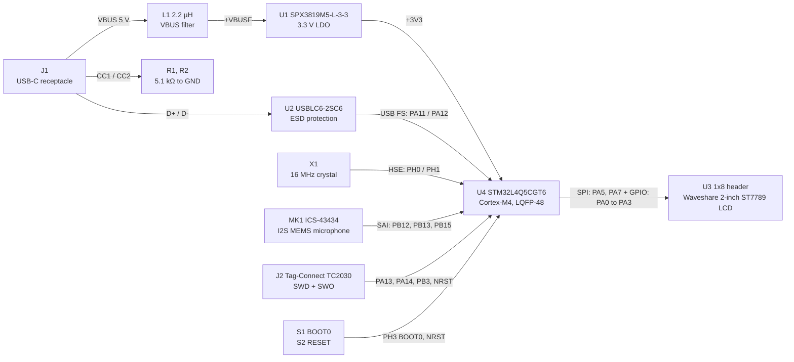

# STM32 Audio Spectrum Analyzer - Custom PCB

A compact 4-layer KiCad board for the audio spectrum analyzer, built around an STM32L4Q5CGT6 with an on-board I2S MEMS microphone, a header for an ST7789 LCD module and USB-C power.

[](LICENSE)


<p align="center">
  
  <br />
  <em>Front of the board in the KiCad 9.0 3D viewer, with all 3D models loaded.</em>
</p>

## Overview

This repository holds the schematic and PCB layout of a custom board for the STM32 audio spectrum analyzer. The original prototype ran on a Nucleo-F767ZI development board. This design uses an STM32L4Q5CGT6 (STM32L4+ series) instead, which reduces the board size while keeping the features of ST's high-performance STM32 lines that this project needs. The board is designed to take power and USB data from a USB-C connector, read audio from an on-board ICS-43434 I2S microphone, and drive a Waveshare 2-inch ST7789 LCD module over SPI.

**Status:** this repository contains only the KiCad design files (schematic Revision A, dated 2026-03-31). It includes no fabrication outputs, assembly data, test results or firmware for this board.

### Features

- **MCU:** STM32L4Q5CGT6, an Arm Cortex-M4 with 1024 KB flash and 320 KB RAM that runs at up to 120 MHz, in an LQFP-48 (7 x 7 mm) package
- **Power:** 5 V VBUS from USB-C passes through a 2.2 µH series inductor to an SPX3819 3.3 V LDO (500 mA)
- **USB:** USB 2.0 full-speed data runs to the MCU's USB OTG FS pins (PA11/PA12), with USBLC6-2SC6 ESD protection and 5.1 kΩ CC pull-down resistors
- **Audio input:** an on-board TDK InvenSense ICS-43434 24-bit I2S MEMS microphone is wired to the SAI2 block A pins
- **Display:** a 1x8 2.54 mm header takes a Waveshare 2-inch ST7789 LCD module over SPI1, with GPIO lines for CS, DC, RST and backlight
- **Clock:** 16 MHz HSE crystal with 10 pF C0G load capacitors
- **Debug and boot:** a Tag-Connect TC2030 footprint for SWD, SWO, NRST and 3.3 V, and tactile buttons for BOOT0 and RESET
- **PCB:** 94.5 x 39.7 mm, 4 layers, two inner GND planes, four M3 mounting holes and three fiducials on each side
- **Sourcing:** every BOM part has its manufacturer, MPN and LCSC part number recorded in the schematic

## Table of contents

- [Hardware](#hardware)
- [Circuit design](#circuit-design)
- [Getting started](#getting-started)
- [Repository structure](#repository-structure)
- [Gallery](#gallery)
- [Related projects](#related-projects)
- [Credits](#credits)
- [License](#license)

## Hardware

### Block diagram



### Bill of materials

The schematic has 38 non-power symbols: 27 BOM parts, the Tag-Connect footprint (J2), four mounting holes and six fiducials. The board has 39 footprints. The extra footprint is the silkscreen outline of the LCD module.

| Function | Ref | Part | Value / package | Manufacturer, MPN | LCSC |
| --- | --- | --- | --- | --- | --- |
| MCU | U4 | STM32L4Q5CGT6 | LQFP-48, 7 x 7 mm, 0.5 mm pitch | ST, STM32L4Q5CGT6 | C1236662 |
| Clock | X1 | Crystal | 16 MHz, 9 pF, ±10 ppm, SMD3225-4P | YXC, X322516MLB4SI | C13738 |
| Clock | C12, C13 | HSE load capacitors | 10 pF C0G, 0603 | Samsung, CL10C100JB8NNNC | C1634 |
| Power | U1 | SPX3819M5-L-3-3 LDO | 3.3 V, 500 mA, SOT-23-5 | MaxLinear, SPX3819M5-L-3-3/TR | C9055 |
| Power | L1 | VBUS series inductor | 2.2 µH, 900 mA, 1206 | Murata, LQM31PN2R2M00L | C171763 |
| Power | C2, C3 | VBUS and +VBUSF (LDO input) capacitors | 2.2 µF, 0603 footprint | Samsung, CL31B225KBHNNNE | C23630 |
| Power | C1 | LDO output capacitor | 2.2 µF 35 V tantalum, case A (3216) | KEMET, T491A225K035AT | C122264 |
| Power | C4 | LDO bypass (BP) capacitor | 100 nF X7R, 0402 | Samsung, CL05B104KO5NNNC | C1525 |
| Decoupling | C5 | Bulk capacitor on +3V3 | 10 µF X5R, 0603 | Samsung, CL10A106KP8NNNC | C19702 |
| Decoupling | C6 to C10 | MCU supply decoupling | 100 nF X7R, 0402 | Samsung, CL05B104KO5NNNC | C1525 |
| USB | J1 | USB-C receptacle, USB 2.0, 16 pins | GCT USB4105 footprint | Kinghelm, KH-TYPE-C-16P | C709357 |
| USB | U2 | USBLC6-2SC6 ESD protection | SOT-23-6 | UMW, USBLC6-2SC6 | C2687116 |
| USB | R1, R2 | CC1/CC2 pull-down resistors | 5.1 kΩ 1 %, 0402 | UNI-ROYAL, 0402WGF5101TCE | C25905 |
| Audio | MK1 | ICS-43434 I2S MEMS microphone | LGA-6, 3.5 x 2.65 mm, bottom side | TDK InvenSense, ICS-43434 | C5656610 |
| Display | U3 | 1x8 pin header for the LCD module | 2.54 mm pitch, through-hole | ZHOURI, 2.54-1\*8 | C5156616 |
| Controls | S1, S2 | BOOT0 and RESET tactile switches | 5.1 x 5.1 mm SMD, 160 gf | XKB, TS-1187A-B-A-B | C318884 |
| Controls | R3 | BOOT0 pull-down resistor | 10 kΩ 1 %, 0402 | UNI-ROYAL, 0402WGF1002TCE | C25744 |
| Controls | C11, C14 | BOOT0 and NRST filter capacitors | 100 nF X7R, 0402 | Samsung, CL05B104KO5NNNC | C1525 |
| Debug | J2 | Tag-Connect TC2030 SWD pads | 2x03, 1.27 mm (not in BOM) | - | - |
| Mechanical | H1 to H4 | Mounting holes | M3, 3.2 mm drill, pads on GND | - | - |
| Mechanical | FID1 to FID6 | Fiducials | 1 mm copper, 2 mm mask opening, 3 per side | - | - |

### Board specifications

| Parameter | Value |
| --- | --- |
| Board outline | 94.5 x 39.7 mm with 1 mm corner radii (Edge.Cuts) |
| Layers | 4 copper layers. F.Cu: signals. In1.Cu: GND plane. In2.Cu: GND plane. B.Cu: signals plus a +3V3 pour |
| Stackup | 35 µm outer copper, 15.2 µm inner copper, 0.2104 mm 7628 prepreg (εr 4.4) on each side of a 1.065 mm core (εr 4.6) |
| Board thickness (stackup) | 1.6062 mm |
| Finish / colors | HAL lead-free, green solder mask, white silkscreen |
| Routing | 370 track segments (331 on F.Cu, 39 on B.Cu) and 61 vias (60 at 0.8 mm / 0.3 mm drill, one at 0.7 mm / 0.3 mm drill) |
| Track widths used | 0.2 mm (signals), 0.284 mm (USB pair, SPI and others), 0.3 mm, 0.5 mm (mainly power) |
| Design rules | 0.15 mm minimum track and clearance (0.2 mm default net-class clearance), 0.5 mm copper-to-edge clearance |
| Assembly | All parts on the top side except MK1 (bottom side) |

### MCU pin assignments

The net labels give these pin assignments. For the signal pins, the peripheral column lists the matching alternate function from the KiCad STM32L4Q5CGTx symbol. The schematic names only the interface (SPI or SAI), not a specific peripheral instance.

| Pin | Port | Net | Connected to | Peripheral function |
| --- | --- | --- | --- | --- |
| 5 | PH0 | HSE_IN | X1, C13 | RCC_OSC_IN |
| 6 | PH1 | HSE_OUT | X1, C12 | RCC_OSC_OUT |
| 7 | NRST | NRST | S2, J2 pin 3, C14 | Reset |
| 10 | PA0 | SPI_GPIO_BL | U3 pin 8 (BL) | GPIO |
| 11 | PA1 | SPI_GPIO_RST | U3 pin 7 (RST) | GPIO |
| 12 | PA2 | SPI_GPIO_DC | U3 pin 6 (DC) | GPIO |
| 13 | PA3 | SPI_GPIO_CS | U3 pin 5 (CS) | GPIO |
| 15 | PA5 | SPI__CLK | U3 pin 4 (CLK) | SPI1_SCK |
| 17 | PA7 | SPI__DIN | U3 pin 3 (DIN) | SPI1_MOSI |
| 25 | PB12 | SAI_WS | MK1 WS | SAI2_FS_A |
| 26 | PB13 | SAI_SCK | MK1 SCK | SAI2_SCK_A |
| 28 | PB15 | SAI_SD | MK1 SD | SAI2_SD_A |
| 32 | PA11 | USBD- | J1 D-, U2 | USB_OTG_FS_DM |
| 33 | PA12 | USBD+ | J1 D+, U2 | USB_OTG_FS_DP |
| 34 | PA13 | SWDIO | J2 pin 2 | SYS_JTMS-SWDIO |
| 37 | PA14 | SWCLK | J2 pin 4 | SYS_JTCK-SWCLK |
| 39 | PB3 | SWO | J2 pin 6 | SYS_JTDO-SWO |
| 44 | PH3 | BOOT0 | S1, R3, C11 | Boot mode select (BOOT0) |
| 1, 9, 24, 36, 48 | VBAT, VDDA, VDD, VDDUSB, VDD | +3V3 | U1 output | Supply |
| 8, 23, 35, 47 | VSSA, VSS | GND | Ground planes | Ground |

The other 21 GPIOs (PA4, PA6, PA8 to PA10, PA15, PB0 to PB2, PB4 to PB11, PB14, PC13 to PC15) have no-connect markers. The board has no expansion header.

### Connector pinouts

<table>
<tr><th>U3: LCD module header (1x8, 2.54 mm)</th><th>J2: Tag-Connect TC2030 (SWD)</th><th>MK1: ICS-43434 microphone</th></tr>
<tr><td>

| Pin | Signal | MCU |
| --- | --- | --- |
| 1 | VCC | +3V3 |
| 2 | GND | GND |
| 3 | DIN | PA7 |
| 4 | CLK | PA5 |
| 5 | CS | PA3 |
| 6 | DC | PA2 |
| 7 | RST | PA1 |
| 8 | BL | PA0 |

</td><td>

| Pin | Signal | MCU |
| --- | --- | --- |
| 1 | VCC | +3V3 |
| 2 | SWDIO | PA13 |
| 3 | RESET | NRST |
| 4 | SWCLK | PA14 |
| 5 | GND | GND |
| 6 | SWO | PB3 |

</td><td>

| Pin | Signal | MCU / net |
| --- | --- | --- |
| 1 | WS | PB12 |
| 2 | LR | GND |
| 3 | GND | GND |
| 4 | SCK | PB13 |
| 5 | VDD | +3V3 |
| 6 | SD | PB15 |

</td></tr>
</table>

## Circuit design

The schematic is a single sheet. It has blocks for USB-C and ESD protection, the 5 V to 3.3 V LDO, the MCU with its oscillator, microphone and display, the serial wire debug and NRST switch, the boot switch, the mounting holes and the fiducials.

- **Power path.** VBUS from J1 has a 2.2 µF capacitor (C2). It then passes through L1 (2.2 µH, 900 mA) to the `+VBUSF` net, which has another 2.2 µF capacitor (C3). `+VBUSF` feeds the SPX3819 LDO. The LDO's EN pin is tied to its input, so the regulator is on whenever USB power is present. C4 (100 nF) sits on the bypass (BP) pin and C1 (2.2 µF tantalum) on the output. One +3V3 rail supplies everything: VDD, VDDA, VDDUSB, the display and the microphone. VBAT is also tied to +3V3, so there is no backup battery.
- **USB.** R1 and R2 (5.1 kΩ) pull CC1 and CC2 to GND, which marks the board as a USB sink. D+ and D- pass through the USBLC6-2SC6 to PA12 and PA11. The project defines a differential-pair preset of 0.284 mm width and 0.2 mm gap, and the USB data lines are routed almost entirely with 0.284 mm tracks. The SBU pins are not connected.
- **Clock.** X1 is a 16 MHz crystal (9 pF load, ±10 ppm) on PH0/PH1, with 10 pF C0G load capacitors. Its footprint has a front-copper keep-out area that blocks copper pour under the crystal. PC14/PC15 are unconnected, so there is no 32.768 kHz LSE crystal.
- **Microphone.** The ICS-43434 is placed on the bottom side, and its footprint has a 0.5 mm acoustic port hole through the board. WS, SCK and SD go to PB12, PB13 and PB15 (net labels `SAI_WS`, `SAI_SCK`, `SAI_SD`). The LR select pin is tied to GND.
- **Display.** A schematic note explains that the display uses a pin header footprint so that a Waveshare LCD module the designer already owns can plug in. The PCB has a silkscreen outline marked "2inch LCD Module" and four 3.2 mm holes for the module's mounting holes. SPI clock and data are on PA5/PA7. CS, DC, RST and BL are GPIO lines on PA3, PA2, PA1 and PA0.
- **Programming and boot.** SWD, SWO, NRST, 3.3 V and GND go to a Tag-Connect TC2030 footprint. The footprint is pads and locating holes only, and it includes a keep-out area for vias and copper pours. S2 pulls NRST to GND, and C14 (100 nF) filters NRST. S1 connects the BOOT0 net (PH3, pin 44) to +3V3. R3 (10 kΩ) holds BOOT0 low, and C11 (100 nF) filters it.
- **Layout.** The left two-thirds of the board is the LCD module footprint, and the electronics fit in the right-hand third. Both inner layers are solid GND pours. B.Cu carries a +3V3 pour named "Power". The net classes (HSE, USB, SW, SPI, SAI, PWR, GND) are assigned by net-name pattern and color-code each interface in the PCB editor.

## Getting started

### Prerequisites

- [KiCad](https://www.kicad.org/) 10.0 or newer. The files use the KiCad 10.0 format (schematic version `20260306`, board version `20260206`), so KiCad 9 and earlier cannot open them.
- Optional: the [JLCPCB KiCad Library](https://github.com/CDFER/JLCPCB-Kicad-Library), installed from KiCad's Plugin and Content Manager, to view every 3D model.

### Open and inspect the design

1. Clone the repository:

   ```sh
   git clone https://github.com/OscarBazylewich/STM32_Audio_Spectrum_Analyzer_CustomPCB.git
   ```

2. Open `STM32L4Q5CGT-AudioSpectrumAnalyzer.kicad_pro` in KiCad 10. The schematic embeds its symbols and the board embeds its footprints, so the project opens without any extra libraries.
3. Open the Schematic Editor to view the circuit, or the PCB Editor to view the layout.
4. In the PCB Editor, open **View > 3D Viewer** to see the assembled board. The models for X1, S1, S2, L1 and C1 are referenced through `${KICAD8_3RD_PARTY}`, the KiCad 8 Plugin and Content Manager folder. If that variable is not defined, or the JLCPCB library is not installed there, those parts appear without bodies, as in the KiCad 10 renders below. To fix this, define the variable under **Preferences > Configure Paths** so it points to the Plugin and Content Manager folder that contains `3dmodels/com_github_CDFER_JLCPCB-Kicad-Library`.
5. Run **Inspect > Electrical Rules Checker** in the schematic and **Inspect > Design Rules Checker** on the board before you generate outputs.

### Generate fabrication files

1. In the PCB Editor, open **File > Fabrication Outputs > Gerbers** and select the copper (F.Cu, In1.Cu, In2.Cu, B.Cu), mask, paste, silkscreen and Edge.Cuts layers. The saved plot settings write to `./`, the project folder, and use the auxiliary origin at the lower-left corner of the board. Set an output folder such as `gerbers/` before you plot.
2. In the same dialog, click **Generate Drill Files** to export the Excellon drill files.
3. Optional: use **File > Fabrication Outputs > Component Placement** for a pick-and-place file, and **Tools > Generate Bill of Materials** in the Schematic Editor for a BOM. The project's BOM settings already include the LCSC, Manufacturer, Manufacturer Part Number and distributor link fields.

The same outputs can be generated from the command line with `kicad-cli`:

```sh
kicad-cli pcb export gerbers --output gerbers/ STM32L4Q5CGT-AudioSpectrumAnalyzer.kicad_pcb
kicad-cli pcb export drill --output gerbers/ STM32L4Q5CGT-AudioSpectrumAnalyzer.kicad_pcb
kicad-cli sch export bom --output bom.csv STM32L4Q5CGT-AudioSpectrumAnalyzer.kicad_sch
```

## Repository structure

```text
.
├── STM32L4Q5CGT-AudioSpectrumAnalyzer.kicad_pro   # KiCad 10 project: design rules, net classes, BOM fields
├── STM32L4Q5CGT-AudioSpectrumAnalyzer.kicad_sch   # Single-sheet schematic (Revision A)
├── STM32L4Q5CGT-AudioSpectrumAnalyzer.kicad_pcb   # 4-layer PCB layout, 94.5 x 39.7 mm
├── .gitattributes                                  # Lets GitHub count KiCad files in its language stats
├── LICENSE                                         # GNU GPL v3.0
└── README.md
```

## Gallery

These are KiCad 3D viewer renders. The KiCad 9.0 renders show every 3D model and have square board corners. The KiCad 10.0 renders have the rounded corners of the committed outline, but they are missing the third-party models for the crystal, the buttons, L1 and C1. The KiCad 10.0 version also added ground pour. In the committed board file, both inner layers carry GND pours and B.Cu carries a +3V3 pour.

<table>
  <tr>
    <th>KiCad 9.0: front</th>
    <th>KiCad 9.0: back</th>
  </tr>
  <tr>
    <td></td>
    <td></td>
  </tr>
  <tr>
    <th>KiCad 10.0: front</th>
    <th>KiCad 10.0: back</th>
  </tr>
  <tr>
    <td></td>
    <td></td>
  </tr>
</table>

## Related projects

- [STM32_Audio_Spectrum_Analyzer_ST7789_and_INMP441](https://github.com/OscarBazylewich/STM32_Audio_Spectrum_Analyzer_ST7789_and_INMP441): the original prototype on a Nucleo-F767ZI, with an ST7789 display and an INMP441 microphone, and its firmware. This repository does not include firmware for the STM32L4Q5 board.

## Credits

- Design by Oscar Bazylewich.
- The footprints and 3D models for X1, S1, S2, L1 and C1, and the symbols for X1, S1 and S2, come from the [JLCPCB KiCad Library](https://github.com/CDFER/JLCPCB-Kicad-Library) by CDFER. The Waveshare LCD module symbol and board outline come from a custom library. All other parts use the standard KiCad libraries.

## License

Released under the GNU General Public License v3.0. See [LICENSE](LICENSE).
